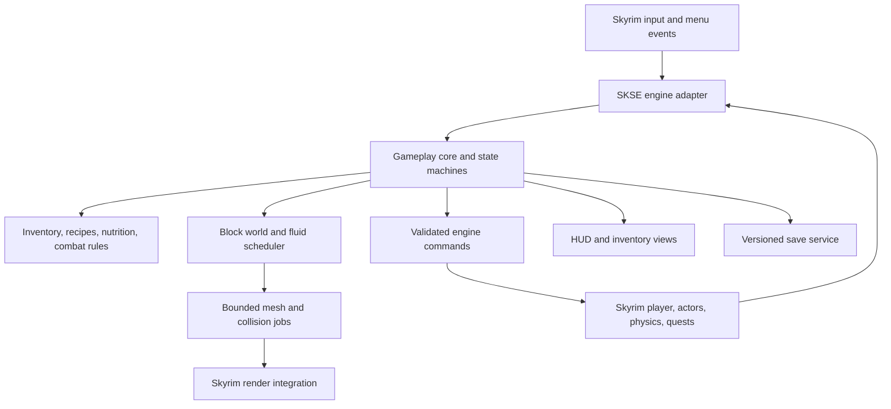

# Native Skyrim mod: design, architecture, feasibility and implementation plan

Date: 2026-10-12. Status: proposal, not an implemented native mod.

## 1. Purpose and verdict

Build a mod that runs **inside Skyrim alone** and preserves the useful experience of the current Minecraft/Skyrim passthrough: responsive movement, Minecraft-style hands/HUD and item handling, building and breaking blocks in Skyrim, crafting, combat, survival, and normal Skyrim quests, conversations, doors, furniture and menus. Minecraft, Fabric, Prism and a second game window must not be required at runtime.

**A substantial native version is feasible. Full fidelity to everything supplied by Minecraft is a major new implementation, not a bridge configuration change.** The current project already proves that custom geometry and interfaces can be drawn inside Skyrim and that native interactions can be invoked. It does not yet prove a native replacement for Minecraft's movement solver, inventory, crafting, block simulation or fluids. These are the largest work packages and must remain visible in scope.

The recommended direction is an SKSE plugin with a small Skyrim-facing adapter, a separately testable gameplay core, content records, original visual assets and a native interface. Skyrim retains its world, quests, NPCs, engine lifecycle and character. The new core supplies the block sandbox and any explicitly chosen Minecraft-style rules. There is one player, one input state and one authority for each piece of state.

Do not sell an early hearts overlay or movement tweak as completion of this goal. Those are useful prototypes on the path to building, inventory, crafting and survival parity. Conversely, this is not a commitment to implement every Minecraft block, mob, dimension, redstone circuit or third-party mod. A concrete compatibility catalog must delimit the systems currently used and the subset the native release promises.

### Reading guide

- Product decisions and current evidence: sections 2–5.
- Architecture and subsystem designs: sections 6–13.
- Feasibility experiments, schedule and acceptance: sections 14–17.
- First implementation tasks, unresolved decisions and sources: sections 18–21.

Everything labeled **proposed** is an engineering/design recommendation, not a user-approved gameplay change. Estimates are planning ranges, not deadlines. Current observations are separated from historical notes, which sometimes contradict newer results.

## 2. Starting point verified for this document

The source inspected is passthrough **0.10.59, protocol 33**, not the earlier failed 0.10.58 test state. Current documentation records 89 Rust tests, 113 Minecraft rule checks and 136 hook checks at the last build. These counts are historical build evidence; no game or native prototype was run for this document.

| Item | Evidence / current state |
| --- | --- |
| Skyrim runtime | Installed executable reports `1.7.104.0`. The SKSE download page lists SKSE 2.3.1 for game 1.7.104 at the date above. Verify the actual SKSE binary before implementation. |
| Minecraft | `minecraft/build.gradle`: 26.3, Fabric loader 0.19.5, Java 25; its engine currently supplies many mechanics for free. |
| Existing native code | Rust `cdylib`, Windows/D3D11 integration and a manually implemented SKSE adapter. It is already a Skyrim plugin, but its gameplay depends on Minecraft. |
| Dependency reference | Local `.tools/CommonLibSSE-NG`, alandtse fork, commit `94faaed0c60eddd8347767f2d4d29a97c93bde8c`. Reference headers are not proof that every call works on this runtime. |
| Last recorded project commit | `5ac01c9`, accepted 0.10.56 work. The .57–.59 changes and launcher are later working files; inspecting only that commit would miss the latest fixes. |
| Healing | Newest STATUS/MODLOG report the user's acceptance of restore-health potions, fortify-health-to-healing conversion and small food heals in .59. Spells remain untested. |
| Chairs | E to sit and E/WASD exit requests are wanted. The .57 blocked-exit repair still lacks the user's gameplay result. |
| Launcher | `Play.cmd` and `tools/play.ps1` start both games; check mode was tested, real launch was not. This launcher is not a native-mod implementation. |

[SKSE runtime download reference](https://skse.silverlock.org/). Project evidence: [STATUS](../STATUS.md), [MODLOG](../MODLOG.md), [README](../README.md), [existing design/history](DESIGN.md), [ABI findings](ABI.md).

**Workspace location at inspection:** `D:\Documents\Vibe coding\SkyCraft attempt\SkyCraft attempt`. The earlier `D:\Documents\ChatGPT\Game modding` path no longer exists. The Git directory is currently one level above the source folder, so Git reports tracked files removed at the old relative locations and the nested source tree as untracked. That pre-existing layout issue was not repaired here. Resolve the intended repository root before staging changes or starting native implementation; do not interpret it as permission to discard or restore working files.

## 3. Product direction and design principles

The proposed experience is **Skyrim's adventure with a block-building and survival layer**, including the movement feel that motivated the passthrough. Skyrim content should continue to make sense: talking to a shopkeeper, equipping loot, sitting, sleeping, using workbenches, shouting, completing quests and dying must remain coherent.

1. One action has one result. A click consumes one potion, one placement consumes one block, and one strike deals damage once.
2. Preserve responsiveness. Building, turning, jumping and opening menus must not wait for a second process or synchronous mesh rebuild.
3. Preserve useful native behavior. Let Skyrim own furniture animations, ownership checks, conversations and door transitions; customize the control rules around them.
4. Define parity explicitly. Matching movement feel, item effects, crafting and building matters more than reproducing bridge workarounds.
5. Expose one understandable character. UI may offer different views of equipment and construction materials, but those views must not silently duplicate items or health.
6. Keep decisions data-driven where practical: block shapes, hardness, recipes, food values, equipment rules and UI labels should be editable without changing engine hooks.
7. Preserve evidence. A successful unit test is not gameplay acceptance. Record both native limitations and user-visible results.

### Potions, food and maximum health: recommended design

The recommendation is **potions for immediate recovery; food for nutrition and gradual recovery; fortify effects for temporary capacity**. This gives preparation and emergency healing different uses. Minecraft's official explanation similarly distinguishes food-supported regeneration from healing potions; exact numerical balance here would be our own. [Minecraft health overview](https://www.minecraft.net/en-us/article/health-minecraft).

| Effect class | Proposed result | Important distinction |
| --- | --- | --- |
| Restore Health potion | Restore the stated native health amount immediately, up to the current maximum. | Does not require hunger to be full. Small fractions must accumulate accurately even if the HUD rounds. |
| Ordinary Skyrim food | Restore hunger and saturation; permit gradual healing under the chosen nutrition rule. | A change from .59, where the native food heal is forwarded directly. Requires approval and matching descriptions. |
| Soups / substantial meals | More sustained nutrition, or an explicit timed benefit. | Do not silently combine full instant healing, nutrition and unlimited stacked regeneration. |
| Fortify Health potion | Increase maximum health for its duration, shown as extra capacity or a clearly marked buff. | .59 instead grants a lasting heal when the bonus rises. That behavior is accepted in the bridge but is a separate design choice. |
| Regenerate Health effect | Modify recovery rate for its duration. | Neither instant restoration nor maximum-health growth. |
| Healing spell | Use the actual spell effect and magicka cost, once. | Must remain available if native spells are in scope; currently untested in passthrough. |
| Unrecognized/mod-added consumable | Preserve native effects and report an unmapped nutrition classification. | Never classify by localized item name or silently remove effects. |

Proposed nutrition profile: hunger declines through active play; food supports recovery between fights; potions remain useful during danger. Initial tuning should compare a Minecraft-like regeneration profile against slower regeneration during combat. Do not assume either is approved. Keep stamina/magicka separate from hunger initially: sprinting can spend native stamina and contribute to hunger, with rates chosen together so it does not become an accidental double penalty.

If hunger is not wanted, keep Skyrim food's modest direct healing and buffs instead. Adding hunger just to reproduce an icon creates needless upkeep. The unanswered product decision is whether gathering/cooking is a central activity or incidental support for building and exploration.

Until that decision is made, the implementation baseline should preserve native food/potion semantics and use configuration for the proposed nutrition conversion. Do not suppress every positive health change: that would also break spells, scripted restoration and other mods.

## 4. Feature inventory and migration scope

Status terms: **played** means the project records user confirmation; **implemented** means source exists but the exact scenario lacks confirmation; **inherited** means Minecraft supplies it, not that this project independently implemented or tested it; **deferred** means not currently working/proven.

| Feature | Passthrough evidence / limitation | Native implementation | Risk / completion evidence |
| --- | --- | --- | --- |
| Walk, mouse look, sprint, jump, crouch | Movement and flat-ground sprint-jumps played. MC owns motion; Skyrim follows. | Native input plus movement controller; match chosen acceleration, air control and jump profile. | High: a controller spike must prove stable steps, slopes, thin walls and repeat jumps. |
| Creative flight and falling after flight | Later ascent/flight-off coverage checks accepted; early versions froze. | Creative mode with collision-aware flight and explicit gravity transition. | High: no tunneling, stuck hover or landing teleport. |
| Skyrim terrain and NPC collision | Sampled terrain boxes; living creatures approximated by human-sized boxes; corpses excluded. | Query actual engine collision; custom blocks add collision separately. | High: avoid inheriting the sampled-cube approximation as the final solver. |
| First-person hand/item/HUD | User confirmed composited Minecraft arms, held items, hearts and inventory. Native hand visibility has a separate unconfirmed fix. | Original hand meshes/animations, selected-item presentation and native HUD. | Medium/high: attack, bow, equipment and furniture camera states must agree. |
| Third-person Minecraft character | Not implemented. | Optional original avatar or native Skyrim body. | New work; not an existing parity claim. |
| Place and break blocks in Skyrim | Static blocks played; terrain-target placement accepted for the iteration; gaps and scale concerns recorded. | Sparse block store, surface raycast, placement rules, native collision and rendering. | High: persist builds and prevent overlap/duplication. |
| Cracks, drops and pickup | Opaque cube cracks; icons and supported block-model drops played. | Mining progress, crack overlay, item entities and exactly-once pickup. | Medium: survival count, durability and save/load tests. |
| Glass, panes, ice and block states | Translucent rendering and extended drops played; no glass/ice crack overlay. | Shape/state registry and transparency ordering. | Medium/high: inspect both appearance and collision, not just cubes. |
| Water/lava and buckets | Rendering and filled-bucket targeting implemented. MC owns flow; fluids pass through Skyrim terrain. | Native fluid simulation, source pickup/placement, damage and visual surfaces. | Very high: independently gate flow and native-terrain containment. |
| Inventory, hotbar, crafting, stacks | Inherited Minecraft systems, separate from Skyrim inventory. Native loot does not become a Minecraft item. | One inventory authority with grid/hotbar views and explicit native/custom item mapping. | High: recipes, ownership, quest items, containers and trading. |
| Weapon recharge, criticals, wear | Played for recorded sword/fist cases; Sharpness/Strength accepted, Weakness untried. | Pure combat rules plus native hit/animation attribution. | High: avoid both custom and vanilla hits on one attack. |
| Armor, shield, incoming damage | Recorded armor/shield checks accepted. Continuous damage pooling implemented but continuous-source gameplay deferred. | One damage pipeline using an explicit armor/difficulty policy. | High: test poison, streams, falling, scripts, hit source and shield direction. |
| Bow | Accepted draw/hit and wall/sky cases. Native hit is an immediate ray test; no visible traveling arrow. | Preserve this baseline if needed; native projectile with gravity is proposed improvement. | Medium/high: one shot/one ammo decrement, collision and attribution. |
| Health potions and food | Played in .59; restore and fortify have different conversion paths. | Native health authority and explicit consumable categories. | Medium: remove synchronization, retain effect semantics. |
| Death and reload | Skyrim death/reload accepted. MC inventory/builds persist while Skyrim rolls back. | Native death plus chosen save policy (section 12). | High product risk: ordinary co-save rollback changes the existing rule. |
| E activation and menus | Conversations, purchases, take/equip/use clicks accepted. E prioritizes native targets; otherwise MC inventory. | Native menu input; context-aware E falls back to the custom inventory. | Medium: do not forward OS clicks between windows. |
| Sit and stand | User wants E to sit, E or WASD to get up; holding initial E stays seated. Blocked exit repair unconfirmed. | Native furniture owns pose; defer locomotion until exit completes. | Medium: chair/table/NPC and seated-save tests remain required. |
| Beds / workbenches | Owned-bed grounding/message accepted; actual sleep and workbenches not tested. | Native activation, ownership and furniture logic. | Medium: real animation/exit and crafting consumption tests. |
| Doors, interiors, travel | Door exit without later teleport accepted; map travel observed. Facing away from exit is requested future behavior. | Native transitions; builds keyed to real worldspace or interior identity. | Medium: no coordinate recovery handshake needed. |
| Shout/power and magic menus | Menu shortcuts present; shout is experimental tap only. | Native bound action, with hold/release for shout duration. | Medium: do not claim spell combat already accepted. |
| Pause / focus changes | Bridge shields player while MC paused/unfocused. | Native pause policy and clearing held input. | Medium: verify focus changes cannot queue damage, movement or clicks. |
| Saving and persistent construction | MC saves blocks/inventory; bridge pairs identities and locations. Historical rollback is not implemented. | Versioned native persistence; import is a separate deliverable. | High: old saves, load-order changes, unloaded cells and missing content. |

### Existing limitations that must not be advertised as finished features

No arbitrary mining of Skyrim landscape/buildings; no NPC collision with placed blocks; no native-water swimming integration; no shared weather/time; no Minecraft mobs, third-person model, block-entity rendering or animated textures in the scene exporter. Crossbows, tridents, thrown items, sweep attacks, Fire Aspect and several creature-specific enchantments are absent or deferred. Kill attribution/crime responses are unverified. General recipes and block interactions inherited from Minecraft require a catalog audit before promising native equivalence.

Building and fluid support are part of this plan. Destructible Skyrim terrain, complete redstone, every vanilla Minecraft item and multiplayer are extensions beyond established project functionality. Nothing in an early milestone silently drops the known building/crafting work.

## 5. What can be reused

| Existing source | Reuse approach |
| --- | --- |
| `passthrough/src/scene_draw.rs`, `overlay_draw.rs` | Proven D3D11 state preservation, camera/depth composition and layering patterns. Refactor away mailbox/atlas transport and fixed bridge origins. Runtime/mod compatibility still needs testing. |
| `position.rs`, `look.rs`, `world_export.rs` | Coordinate math, collision investigations and diagnostic cases. Do not retain per-frame puppeting or a four-block sampled coverage dependency. |
| `attack.rs`, `damage.rs` | Native call findings and observations about effects. Re-audit every hook; remove health suppression, cross-game healing forwarding and duplicate queues. |
| `interaction.rs`, `menu_input.rs`, `seat.rs`, `recovery.rs` | Interaction rules and difficult reproduction cases. Replace window forwarding and two-character recovery with native state transitions. |
| `saved_origin.rs`, `save_identity.rs`, `death.rs` | Save-identity lessons and lifecycle tests. Do not reuse coordinate-region hashes as canonical persistent identities. |
| Java `BridgeRules.java` and `diagnostics/RulesCheck.java` | Port pure formulas and applicable behavioral fixtures, then test against both implementations. |
| Java scene/drop/fluid captures | Feature specification and rendering test cases. They depend on Minecraft's registries, tessellator and world and cannot simply run in Skyrim. |
| Fabric mixins, `NativeLink`, shared-memory protocol | Retire from the native runtime. They remain valuable reference material for the bridge. |
| Logs/checker/build scripts | Adapt log conventions and validation discipline. Create a separate native package target; current builders and installer produce/install the bridge. |

The Rust code is reusable in parts; the Java adapter is not a self-contained Minecraft engine. Do not embed a JVM or Minecraft server in Skyrim as a hidden shortcut: that retains the dependency and a second simulation authority.

## 6. Proposed architecture

### Component arrangement



There is no shared-memory connection, paired heartbeat, second player, foreign-window focus transfer, Minecraft region teleport or framebuffer transfer.

### Language and engine boundary

**Recommended:** C++ engine adapter using the locally inspected CommonLibSSE-NG family; Rust core for portable state, transactions, storage and reusable rules. Use a small C ABI with plain values, handles, lengths and result codes. This retains useful Rust while avoiding further hand-written C++ layout/virtual-call declarations across the entire game.

A single C++ implementation is a reasonable alternative if maintaining two build toolchains would overwhelm the team. Do not choose both by accident: complete a build/FFI spike before core work. Papyrus can handle content-facing glue or quest integration; do not put per-frame movement, mesh building or fluid stepping in scripts.

The inspected CommonLib interfaces expose task dispatch and serialization callbacks, including FormID resolution; the character-controller headers expose position/velocity operations. Those are useful integration surfaces, not guarantees of correct call timing or runtime compatibility. [SKSE interfaces](https://raw.githubusercontent.com/alandtse/CommonLibSSE-NG/ng/include/SKSE/Interfaces.h), [character-controller declarations](https://raw.githubusercontent.com/alandtse/CommonLibSSE-NG/ng/include/RE/B/bhkCharacterController.h).

### State authority

| State | Sole authority in proposed default architecture |
| --- | --- |
| Native world, actors, quests, crime, ownership, time/weather | Skyrim |
| Player actor, furniture/animation state, cell, actual health/stamina/magicka, death | Skyrim; custom rules apply through one validated adapter |
| Locomotion intent | Custom controller when free; Skyrim when furniture, dialogue, scripted controls or death owns the actor |
| Inventory counts and equipped instances | Skyrim inventory with mod-owned definitions/metadata; custom UI is a view, not a second bag |
| Block cells, custom drops, flow state, recipes/definitions | Gameplay core |
| Hunger, saturation, custom weapon durability and hotbar bindings | Core, tied to stable actor/item identities |
| Render state | Derived immutable snapshots; never the source of gameplay truth |

If exact Minecraft damage timing or a separate persistent custom inventory is selected, revise this authority table first. Do not quietly add a parallel health number or item count to make one feature easier.

### Threads, ticks and object lifetime

- Read/mutate game objects only on the appropriate engine task/update path. Hold no gameplay lock while invoking engine callbacks that may re-enter the plugin.
- Worker jobs receive copied values and immutable definitions, never live actor pointers. Resolve engine handles on the engine thread and reject stale generations after load/unload.
- Use a fixed 20 Hz core simulation for rules intended to resemble Minecraft. Interpolate visuals; integrate collision at the engine physics step or a verified bounded substep rate. A 20 Hz rules tick alone is insufficient for reliable fast movement.
- Bound catch-up steps. Pausing/loading clears elapsed-time debt; reopening a menu must not execute minutes of hunger, fluid or movement updates at once.
- Render hooks consume ready snapshots and upload within a budget. They do not scan the entire world, write saves, wait for workers or touch inventory.
- Never unwind Rust panics or C++ exceptions across FFI/engine hooks. Validate lengths, finite numbers and version tags at module boundaries.
- On critical controller failure, stop custom movement and return native control at the last verified supported position. On a block collision failure, refuse new placement; never display a supposedly solid bridge that has no collision.

Proposed state machine: `Loading -> Ready -> FreeMovement`, with `Menu`, `FurnitureEntering`, `FurnitureActive`, `FurnitureExiting`, `Travel`, `Dying`, `Paused` and `Degraded` states. A load increments a generation; commands from previous generations are invalid. Native state transitions take precedence over queued custom actions.

## 7. Movement, collision, camera and interactions

### Movement strategy and feasibility gate

Start with **native collision resolution plus custom movement intent/velocity**, rather than teleporting the player every frame. Measure the engine's behavior before choosing a deeper override. Tune sprint speed, acceleration, friction, jump impulse, air steering and step height against a recorded passthrough route. Gravity and velocity must have exactly one owner in each mode.

The first spike must establish which controller update stage can accept custom intent without native locomotion applying a second displacement. The old bridge's position writes and gravity suppression are evidence about control access, not a safe general locomotion implementation. A sweep/slide controller against engine collision is the fallback research route if native locomotion cannot give the required feel. That route adds contact resolution, stairs, slopes, moving supports, actor interaction and animation synchronization; it is a major risk, not a small extension.

Use the current **70 Skyrim units per block** as a measurement baseline only. It is hard-coded in the existing shader and mapping and has drawn size/reach complaints. Centralize world scale, player dimensions, reach and step height. Validate them with doors, furniture, stairs and placed blocks before fixing the release format. Save each world's grid transform; changing the default scale must not silently resize existing builds.

Required cases: flat repeated sprint-jumps; stair runs; uneven slopes; low ceilings; narrow doorways; moving NPCs of different sizes; a corpse; long falls; flight ascent/descent; turning flight off near the ground; cell loading during motion; and stable standing without camera drift. Exact frame-by-frame Minecraft trajectories are a separate promise from a similar feel.

### Native ownership transitions

- **Furniture:** E activates native furniture. After entering, native animation and the native controller own placement and eye height. Holding that same E press does not request exit. A later E press or a fresh WASD press requests native exit. Suppress custom movement until the exit state has ended and support is valid; consume/reset the exit input so it does not launch the character forward.
- **Blocked furniture exits:** first allow Skyrim's own exit handling. If a verified failure remains, test a bounded safe-point recovery while standing, with real collision and NPC clearance. Never move a seated actor through the table or force a camera-height coordinate into a feet coordinate.
- **Beds/workbenches:** use actual native grounding, ownership and animation conditions. The previous 'cannot sleep in the air' issue came from the bridge's puppet state; native control removes that particular arrangement but still needs gameplay validation.
- **Doors/travel:** preserve Skyrim's destination until transition completes. Clear movement and look deltas so a held key cannot create the reported post-door displacement. Facing away from the door is an optional later orientation feature, validated against the actual arrival marker and obstacles.
- **Death/scripted scenes:** release custom control; use native death and scripts. Never pin health positive to keep a controller running.
- **Pause/focus:** clear held buttons and simulation debt. Define whether focus loss pauses world simulation; do not combine hidden invulnerability with a world that otherwise keeps running unless that is a selected mode.

### Camera and hands

Native camera remains authoritative. Implement first-person hands as original assets through a proven engine viewmodel path if practical; an isolated render pass is a fallback with explicit depth/FOV rules. Match equipment and attack animation timing. Avoid duplicate native/custom arms, especially at low chairs, crafting benches, swimming, death and third-person transitions. The seating camera is allowed to be lower without changing collision feet.

Preserve native spell/shout cameras and animation events. A hotbar selection and a two-handed/native spell loadout need a clear precedence rule. Original block-style hand animations are real asset work and cannot be replaced by a Minecraft screenshot once that process is removed.

## 8. Block world, mining, rendering and fluids

### Persistent world model

Use a sparse grid over **native Skyrim places**, with no generated Minecraft terrain. Suggested keys:

```text
PlaceKey = Exterior(stable worldspace identity)
         | Interior(stable cell identity)
GridTransform = origin + orientation + unitsPerBlock + formatVersion
ChunkKey = PlaceKey + integer chunk X/Y/Z
BlockCell = definitionKey + stateProperties + optional instanceData
```

Exterior cells within one worldspace share a continuous grid; entering another exterior cell must not move the grid. An interior has its own space. Identify plugin-defined forms by plugin identity and local ID, with engine-supported resolution at load; resolve light plugins correctly. Do not key by a raw load-order-dependent FormID, display name or the low bits of an ID. Dynamic references need separately persisted identities. Use integer block coordinates and local floating origins for render precision at large distances.

A practical initial chunk is 16×16×16 cells, with a sparse map of nonempty chunks, per-chunk revisions and a block-state palette. That is a proposal, not a restriction to the bridge's short 16-cubed visible snapshot. Dirty borders also invalidate adjacent chunk meshes. Save logical cells, not GPU vertices or collision pointers.

### Placement and mining transaction

1. Raycast from the actual camera against native world geometry, custom block shapes and relevant actors; choose the nearest permitted target within reach.
2. Convert the selected surface to a grid cell deterministically. Use real normals; document remaining partial-grid gaps instead of inventing invisible supports.
3. Validate actor overlap, existing contents, attachment/support rules, protected locations, available item and current place/generation.
4. Prepare required collision/render resources asynchronously while keeping the candidate visibly a preview only.
5. At a safe engine update, revalidate; atomically commit the logical block and item consumption, activate ready collision, then publish the visual change. If the commit cannot complete, retain the old state and inventory.
6. Mark a save revision and emit a transaction result. Repeating the same transaction ID is a no-op.

Mining advances by simulation time using tool, block hardness and enchantment rules in the catalog. Changing target or opening a menu cancels or suspends progress according to the selected rule. On completion, remove the block once, spend durability once and create one loot result. A drop is either in the world or in an inventory, never both. Persist uncollected drops or explicitly select a documented expiry policy.

Native Skyrim stone, houses and quest objects remain non-voxel terrain. Destroying them would require a separate world-editing/content system, collision replacement, navmesh handling and quest safeguards.

### Block rendering and physical collision

Two approaches should be measured:

| Approach | Advantages | Limits / recommended use |
| --- | --- | --- |
| Preauthored native objects with collision | Quick proof, native selection/lighting behavior, low initial tooling cost. | Per-block references and draw calls can grow badly; suitable for the first dozen-block prototype, not assumed scalable. |
| Chunk meshes plus chunk collision | Fewer objects and draw calls; matches sparse block data and frequent edits. | Need meshing, materials, collision creation/update, lifecycle and render integration. Recommended production direction if proven. |

Reuse the existing depth-aware renderer as a prototype, with locally generated meshes and original textures. It currently draws against Skyrim depth; drawing geometry does not make it physically solid, cast shadows, participate in native picking or affect AI. Each of these must have its own implementation/test. Start with opaque cubes, then slabs/stairs/panes and transparent surfaces, cracks and drops. Lighting, shadows, fog, underwater views and transparency are separate render acceptance cases.

For collision, investigate supported engine creation paths using authored collision templates or validated native shape factories. Do not assume a freely redistributable Havok authoring SDK or arbitrary runtime mesh-cooking API exists. Coalesce neighboring cube collision and preserve accurate special shapes. Update collision at a verified safe physics boundary; keep old geometry alive until no simulation step references it. Test removing the block currently supporting the player.

NPC physical collision is a desirable improvement over the bridge but **does not provide navigation**. An NPC can be stopped by a new wall while its path still goes through it. Full dynamic navmesh rebuilding is not established. Prototype a limited obstacle-aware policy and preserve escape routes around quest doors; until proven, document placement restrictions or limited NPC avoidance. Do not promise NPCs can navigate arbitrary player-built staircases.

### Fluids

Native Skyrim water planes are not a general-purpose voxel fluid solver. Removing Minecraft removes its water/lava simulation. Rebuild source/flow cells, scheduled updates, neighbor rules, bucket transactions and mesh surfaces for the agreed subset.

Stage fluid work separately:

1. **Parity tier:** water/lava sources, flow over custom blocks, pickup/placement, survival empty-bucket return, creative retention, appropriate damage. Initially match only the declared subset of existing behavior.
2. **Terrain integration tier:** obtain cached terrain occupancy/face barriers; prevent flow through native walls/ground and around loaded-region boundaries. Choose and document treatment of partial surfaces. Unknown terrain must suspend propagation rather than silently drain liquid.
3. **Extended tier:** waterlogging, fluid interaction reactions, swimming/buoyancy and wider simulation, according to the catalog. These cannot be claimed merely because a water surface draws.

Use bounded dirty-cell queues with deterministic ordering. Limit updates per tick and active regions; persist pending work or rebuild it deterministically. Unloading an interior must neither erase its fluid nor simulate an unbounded backlog on return. Native terrain changes invalidate affected occupancy caches. Native water swimming can use Skyrim's swimming behavior independently of custom voxel-water rules; test their boundary rather than treating the two as identical.

## 9. Inventory, equipment, crafting and content

### One inventory with multiple views

The default proposal uses native inventory counts for both ordinary Skyrim items and authored construction/tool items. Grid inventory, hotbar, favorites and native menus are views of the same items. This improves on the bridge's two unrelated inventories but is a deliberate design change requiring agreement.

A hotbar stores references to item definitions or unique instances, not copied item stacks. Select an existing instance when its quantity changes; clear a binding when none remains. Equipped weapon/armor state should be native whenever possible so NPC reactions, scripts, animation and perks can see it.

Durability and per-instance custom enchantments need stable identities across split, merge, drop, transfer and save/load. Prototype a suitable extra-data/serialization mechanism and its conflict behavior before a full item catalog. Do not key unique items only by base FormID; two swords can have different durability. Avoid creating a runtime Form for every placed cube.

### Catalog and recipes

Create versioned data definitions for:

- Blocks: stable key, states, model/material, collision/selection shapes, hardness, tool requirements, drops, support rules, fluid behavior and item representation.
- Items/equipment: stable key, native form mapping, stack/weight policy, tags, durability, damage/speed, enchantment support and presentation.
- Recipes: shaped/shapeless inputs, quantities, output, remainders such as buckets, station requirements and unlock conditions.
- Consumables: native effects, nutrition classification, duration and displayed description.

Inventory capacity and weight require an explicit rule. Combining a strict Minecraft slot cap with Skyrim carry weight without explanation can punish players twice. The recommended first catalog uses native weight plus a paged grid; a strict slot-based mode is a separate product option.

Crafting is a transaction: validate all ingredients and available output space, consume inputs, produce output/remainders and apply skill/perk effects once. Native workbench recipes should remain available. Decide which recipes appear at the portable grid, crafting table and native workbenches. Recipe output is not evidence that the necessary materials are obtainable in Skyrim: add merchant, loot or resource recipes deliberately and test a survival progression without creative spawning.

The first implementation task for catalog scope is to inspect the user's existing builds and used items, then record an exact list of required definitions and states. Include non-full blocks, containers, tools, bows, food and buckets used in those saves. Unknown definitions must remain recoverable data, not silently become air.

### Native UI/input

Use native event handling and a custom menu/HUD. Scaleform integration is the initial candidate; keep a rendering-only overlay from owning inventory mutations. Controller input, keyboard navigation, resolution/DPI scaling and remapping require explicit testing.

Retain the familiar intent: E activates a valid native target; E on empty space opens the inventory; E or WASD exits a seat; mouse click in native inventories takes/equips/uses the selected item. While menus are open, neither click nor WASD can also attack/move/place blocks. Use normal native menu actions instead of the bridge's forwarded click machinery. Native text entry and key rebinding should work without cross-window translation.

## 10. Combat, health, hunger and death

### Health authority and HUD mapping

Use Skyrim's actual current/maximum health as the character's health. Remove the bridge's suppression/forwarding loop rather than preserving a second number for hearts. A healing potion changes health once through its native effect; the HUD observes the result. Engine effects, scripted damage and restoration must keep working when the custom HUD is hidden.

Proposed display model: ten base hearts represent the unfortified maximum, with partial hearts and additional temporary capacity for fortify effects. For baseline maximum `B`, display current heart-equivalents as `10 * currentHealth / B` and capacity as `10 * effectiveMaximum / B`. For example, at B=100, restoring 25 health is 2.5 hearts and a +20 maximum effect adds two hearts of capacity. Retain full precision internally. This differs from .59's restore conversion using a possibly fortified maximum; it is a new display policy, not a diagnosis of a bug.

Decide how level-up maximum increases affect the number of hearts versus health per heart. On buff expiry, follow and test native current/max behavior; do not add a second removal that damages the player twice. Fortify capacity is not Minecraft absorption, which absorbs damage as a separate pool. If absorption is wanted, specify it separately.

### Damage and equipment policy

The bridge currently combines native damage with Minecraft armor/shield treatment and a 1.75 outgoing scale. That scale was a balance choice, not a universal conversion law. A native build must select one of these policies:

- **Recommended native integration:** retain Skyrim damage, armor, difficulty, perks and effects; add custom weapon recharge/critical/durability behavior at a verified stage. Design item tiers against native encounters. This best preserves Skyrim mods/content but is not exact bridge damage parity.
- **Strict custom combat:** replace the relevant calculation stage with the specified Minecraft-style rules, while preserving native attacker/victim attribution, hostility, crime, deaths and script events. This is much more intrusive and conflicts with other combat overhauls.

For either policy, document the order of base damage, recharge, enchantments, criticals, difficulty, resistance/armor and shield blocking. Prevent an attack from applying both the custom direct hit and the native animation hit. Port the current formulas as fixtures, not as unquestionable balancing targets. Use the real attacker for block direction, not the nearest NPC approximation.

Incoming damage must cover weapon strikes, sustained flames/frost, poison, falls, drowning, scripts and environmental damage. Avoid inheriting Minecraft's hit-pause losses or applying a second armor reduction to damage already mitigated by Skyrim. Healing must never enter a damage pool. A native projectile is preferred for future visible arrows, but its ballistic behavior differs from the current straight-line shot and needs acceptance.

### Nutrition integration

If the nutrition proposal is accepted, hunger/saturation are core-owned state. Native food consumption triggers one classified nutrition transaction; it is not inferred from an arbitrary health increase. Configure which vanilla food heal effects are replaced and leave unrelated buffs alone. Unknown food retains native behavior. For mod-added food, offer explicit mapping rules and diagnostics.

Choose one owner of natural regeneration: native regeneration, or the nutrition controller invoking a defined restore rate. Enabling both by accident would double-heal. Resting/waiting, menu pause, difficulty, combat, starvation floor and survival-mode compatibility need tests and settings. A hunger subsystem must not run alongside another survival mod's hunger unless an adapter deliberately delegates ownership.

### Death

Use native death and reload, releasing custom input/controllers. Do not auto-heal to keep building mode alive. Clear queued attacks, consumption and movement on death/load. The critical unresolved question is whether inventory and construction roll back with the Skyrim save; see section 12. That choice affects implementation more than the visual death screen.

## 11. Native lifecycle, compatibility and failure handling

Initialization order: validate runtime/dependencies -> register events/serialization -> load content definitions -> validate engine integration -> initialize UI/render support -> wait for a playable loaded world -> attach the session. Do not run gameplay against title-screen or partially loaded objects.

Start by supporting Windows x64 **Steam 1.7.104** only. Use matching SKSE and Address Library data; record verified versions and hashes in a build manifest. An Address Library lookup does not prove a signature, layout or semantic contract. Verify relocation targets and hook preconditions; fail closed for an unsupported runtime. GOG, older SE/AE and VR need independent compatibility work, not a claim based on the library name. SKSE lists platform restrictions on its official page. [SKSE compatibility](https://skse.silverlock.org/).

Test the native mod without `passthrough_link.dll`; prevent both controllers from loading together in the supported installation profile. Keep bridge and native packages separately named. A mod manager profile should install the new DLL, content plugin, scripts if needed, interface assets, meshes/textures, definitions and settings. It must not need Minecraft, Java, Fabric, Prism or the old two-game launcher to play.

Compatibility targets must name the actual mods tested. Initially test stock Skyrim plus required dependencies, then one representative UI, camera, combat, survival and render modification at a time. Hook chaining, render state restoration, UI conflicts and controller ownership need feature-level reporting. Disabling an optional UI feature should leave native menus accessible; disabling core block collision must stop block gameplay safely.

Feature settings should be explicit (`movement`, `building`, `custom_combat`, `nutrition`, `custom_hud`, `fluid_simulation`). A setting is not a guarantee of safe mid-save removal. Save the active ruleset/version where it affects persistent state. Log unavailable capabilities and the practical result; avoid continuing silently with half of a transaction.

## 12. Saves, rollback and optional migration

### Choose save semantics before inventory work

The user previously chose Skyrim-style death/reload while Minecraft inventory and blocks survive. Standard SKSE co-save behavior would instead restore custom state belonging to the selected save. This is a product decision, not a detail an implementer may change unnoticed.

| Mode | Semantics | Cost / recommendation |
| --- | --- | --- |
| Coherent Skyrim saves | Native items, custom metadata, hunger and constructions all restore to the selected save revision. | Recommended for simplicity and consistency, but changes current behavior and needs user agreement. |
| Preserve bridge behavior | Skyrim story/native state rolls back; custom construction and the designated custom-item state remain at the latest campaign revision. | Required if the existing death rule must be retained. Needs a separate durable ledger and duplication/conflict handling. |

Do not claim full gameplay parity until the chosen behavior is approved and tested. Keeping old save files untouched is different from preserving the semantics of loading them.

### Coherent-save implementation

Use SKSE serialization callbacks for small metadata and a versioned chunk store when data is too large for a practical co-save. Every co-save references an immutable snapshot/revision, never an unqualified mutable 'latest'. Save records include schema, mod version, campaign ID, ruleset ID, grid transforms, stable form mappings, chunk revision index, custom item metadata, hunger and pending scheduled state.

For larger snapshots: create/checksum immutable chunk blobs first, atomically publish a complete manifest, then write its identity into the co-save callback. The game save and an external file are not a single atomic transaction. Loading must verify the referenced complete snapshot, reject incomplete generations and report a missing snapshot clearly. Retain referenced versions for old saves; do not garbage-collect by newest timestamp alone. Begin with bounded data directly serialized if that can meet the initial scale target.

Save/load/revert callbacks clear transient caches and pending commands. Resolve forms with the serialization interface and stable plugin identities. Preserve unknown block definitions as unavailable records for recovery. A missing content plugin must not delete a player's world. Schema migration reads old data into a new version and preserves a backup; an unknown newer schema is rejected, not guessed.

### Persistent campaign ledger if bridge semantics are retained

Use an explicit campaign UUID and transactional event journal for construction and the selected custom inventory category. Checkpoint it independently of Skyrim's story saves. Each mutation has a unique sequence and commit marker; restart replays committed operations exactly once. Old Skyrim saves must explicitly attach to, or fork, the campaign lineage rather than guessing by filename.

This conflicts with the proposed unified native inventory: Skyrim rolls native counts back. A chosen reconciliation strategy must distinguish ledger-owned custom items from native quest/loot items, reapply only the former after load and prevent resurrected old-save copies. Either maintain a dedicated core-owned custom inventory with clearly separated native items, or implement a proven reconciliation protocol for custom forms. Revise the authority table accordingly.

Conversion/trading between persistent and rolled-back categories can duplicate value when old saves are loaded. Define whether such transfers are blocked, journaled with reconciliation, or accepted as a user-visible sandbox exploit. This must be solved before claiming an integrated survival economy under persistent mode. No external ledger may rewrite quest state to make the numbers match.

### Existing bridge save import

Running natively and importing existing builds are separate deliverables. A native release can start a fresh profile while an importer is developed, but must not imply old Minecraft worlds automatically open.

A future offline importer should read copies of the specific 26.3 save format, its exact data version, bridge pairing/origin records, block states, inventory and supported item metadata. Reconstruct every place's transform, including historical home origins, interior/worldspace regions and any height changes. The low-bit region mapping has collision/load-order limitations; ambiguous places require explicit mapping, never a guessed destination.

Produce a dry-run report of counts, unsupported definitions, coordinates and inventory conversions before creating a new native snapshot. Preserve original worlds and Skyrim saves; never modify them in place. Unknown blocks/items are quarantined in the report and recoverable data. Validate inventory totals and sample landmark coordinates before accepting the import. Minecraft can be a development/import source without being a native gameplay runtime dependency.

## 13. Performance, diagnostics and packaging

Removing a second game should remove cross-process stalls and reduce duplicated simulation, but it does not guarantee better frame time. Chunk meshing, collision updates and native hooks can still freeze Skyrim. Measure against stock Skyrim on the same save, route, settings and hardware.

Proposed initial budgets, to refine after profiling:

| Area | Initial target and response to overload |
| --- | --- |
| Engine-thread custom work | Under 1 ms at the 95th percentile on the reference PC during ordinary play; bounded jobs rather than full rebuilds. |
| Stalls | No mod-attributable 50–100 ms jump/focus/build pauses. Log any individual task above 5 ms for investigation. |
| Block rendering | Record CPU/GPU cost separately at 1k, 10k and 100k saved blocks with a bounded active area. These are stress points, not guaranteed capacity. |
| Placement feedback | Preview responds within a rendered frame; resource preparation may delay commit with visible pending feedback rather than freezing. |
| Memory | Track active mesh/collision bytes, cache limits and deferred-release queues; unload/reload loops must reach a plateau. |
| Fluids | Fixed per-tick update budget, queue size metrics and deterministic suspension outside active regions. |
| Saving | Track snapshot size/duration and load-time migration; no synchronous world-sized rebuild inside a render/input callback. |

Logs should identify build/runtime, enabled rules, session/save generation, action sequence, item/block definition, native effect class, actual health before/after, controller state, collision/mesh revision and rejection reason. Log state changes and bounded samples rather than writing every frame. Include percentile summaries; retain enough events to reproduce a rare failure without exhausting a raw-effect log quota on zero-value calls.

Build a separate `native` artifact with pinned dependencies, version manifest and hashes. Provide a repeatable build command only after the build target exists; current `build-step5b.ps1` and `install-build.ps1` are bridge tools and must not be presented as native installers. Package only our code/assets and explicitly permitted dependencies. Maintain an asset-origin manifest. Plan original textures, meshes, icons and sounds instead of copying Minecraft runtime atlases into a release. Check the applicable dependency licenses and game asset terms before distribution; purchasing a game is not an asset redistribution plan. [Minecraft usage guidelines](https://www.minecraft.net/en-us/usage-guidelines), [CommonLib source and license files](https://github.com/alandtse/CommonLibSSE-NG).

The inspected CommonLib checkout declares GPL-3.0-or-later with named exceptions in `COPYING.txt`/`EXCEPTIONS.md`. Pin and read those exact files when choosing the native plugin's distribution/license model; do not assume every fork has identical terms. This document does not select the project's license.

## 14. Feasibility assessment and early experiments

The confidence labels below are engineering judgments based on the inspected bridge and engine interfaces. They are not test results for a native implementation.

| Area | Confidence | Main unknown / consequence |
| --- | --- | --- |
| Single-process plugin, native menus, observing native health | High | Runtime validation and UI integration remain necessary; no second health bridge is needed. |
| Hearts/hotbar and original first-person presentation | Medium–high | Asset/animation work and compatibility with camera/UI changes. |
| A small set of placeable solid blocks | Medium–high | Creating/updating valid native collision safely; render proof alone is insufficient. |
| Scalable block sandbox with saves and crafting | Medium | Content catalog, chunk collision, transactions and persistent instance identities. |
| Matching the preferred Minecraft movement feel | Medium | Skyrim controller behavior, update order and animation coupling. Exact physics parity is lower confidence. |
| Native potions/spells with hearts | High for native effects; medium for redesigned nutrition | Preserve one effect/health authority and test modded effects. |
| NPC collision with builds | Medium | Physical obstacles are attainable in principle; useful AI navigation is a separate low-confidence area. |
| Dynamic NPC paths through arbitrary builds | Low / research | No proven runtime navmesh solution in this project. |
| Water/lava equivalent to the current limited bridge | Medium | New simulation is required even though the bridge inherits it. |
| Fluids correctly contained by all native geometry | Low–medium / research | Terrain sampling, thin/partial surfaces, cell lifecycle and bounded simulation. |
| Full Minecraft engine/content equivalence | Low as a practical scope | Vast feature set and assets; not justified by the existing adapter or current tests. |
| Import of existing builds and inventory | Medium–low until format/identity audit | Save schemas, content mapping and historical origins may be ambiguous. |

### Required prototypes and go/no-go criteria

Each prototype produces source, a reproducible test scene/route, logs and a short result note. Timebox investigations; a failed gate changes the plan transparently rather than being hidden behind another feature.

**P0 — Runtime and lifecycle (first):** load an independent plugin on 1.7.104 with the bridge disabled. Observe player health, open/close a small native menu, and round-trip a versioned save record. Test main menu, new game/load, quickload, death, shutdown and unsupported-runtime rejection. Pass only if there is no Minecraft process/runtime requirement and no stale object access across a load. Confirm the C++/Rust boundary and build recipe here.

**P1 — Locomotion (early critical gate):** controlled jump/run course, stairs, ceiling, slopes, chair and door transition; then flight and long fall. Compare recorded route times, jump apex/airtime and input response with the accepted bridge. Pass if the user accepts feel and there are no unsupported controller states, recurring stalls, clipping or drift. If the native-controller approach fails, estimate the full sweep/slide controller before committing to it. Vanilla-feeling movement is not automatically an acceptable substitute.

**P2 — Real blocks (early critical gate):** place twelve original-texture blocks, walk/jump on them, remove a supporting block, enter/leave the cell and reload. Add a slab and transparent pane. Check player and NPC collision independently. Pass only if visual, selection, physical and saved state agree. Then stress chunk geometry/collision at increasing density; choose the production representation from measured results.

**P3 — Inventory and persistence (before a catalog):** two different durability instances of the same tool, a stack split/merge, one recipe with a remainder, a container transfer and a save/load. Re-run after death and an old-save load under the selected save policy. Pass if no counts or metadata duplicate/disappear and the same item has one authority across native/custom views. If persistent campaign mode is required, prototype its native-inventory reconciliation now.

**P4 — Fluid and native geometry (before broad content promises):** a bucket beside a sloped floor, a thin wall and a doorway; unload/reload mid-flow. Prove bounded work and declared boundary behavior. A cube-only demo does not establish native-world fluid containment. If containment is infeasible within budget, report the exact supported fluid subset and obtain a scope decision.

**P5 — Damage and effects (before combat overhaul):** one native hit, sustained damage, a restore potion, fortify potion, food and a healing spell, with menus and load transitions. Compare actual actor values with the HUD. Pass only if each effect happens once, fortify expiry is distinct from healing, and native death works. If strict custom combat is chosen, also prove crime/kill attribution and no double damage.

P0 precedes all integration work. P1, P2 and P3 determine whether the central experience is viable. P4 must happen early enough to avoid promising fluids after committing months to content. P5 settles health/combat ownership. UI polish should not consume the feasibility budget ahead of these gates.

## 15. Delivery plan and scope checkpoints

| Milestone | Deliverable | Exit criterion |
| --- | --- | --- |
| M0: decisions and baseline | Agreed feature catalog, movement target, health/food profile, inventory/save policy, runtime support; isolated native development profile. | Every change from bridge semantics is named; reference routes and save copies available. |
| M1: feasibility package | P0–P5 results and a runnable small native prototype. | Movement, solid blocks and persistence gates pass; remaining risks have explicit scope decisions. |
| M2: native character and interaction | Movement/flight, camera/hands, HUD, E behavior, menus, furniture, doors, pause, native health/death. | The known user scenarios pass without either Minecraft or the bridge plugin. |
| M3: persistent building | Block registry, shapes, mining/drops, collision, streaming, renderer, chunk saves and chosen rollback semantics. | A build survives travel/restart correctly; no visible/physical mismatch or duplication. |
| M4: usable survival loop | Item mappings, hotbar, crafting, resource acquisition, equipment/durability, selected combat and nutrition. | Start a fresh survival character and obtain/craft/use/build without debug item spawning. |
| M5: fluids and catalog parity | Agreed water/lava/bucket behavior, remaining declared block/item states, compatibility fixes. | Catalog coverage and fluid tests pass; unsupported items are clearly identified. |
| M6: migration and release candidate | Importer if required, packaging, fresh-install instructions, profiling, compatibility matrix, save-recovery notes. | End-to-end checklist passes in a clean profile; another person can build/install/test from written instructions. |

M2 is a playable slice, not completion of the block-building mod. M3–M5 are essential for the declared sandbox scope. Importing old saves is required only if selected as a release requirement; explicitly state its status in any release.

### Rough effort and team needs

For a developer already comfortable with native Skyrim plugins, allow roughly **2–6 weeks for the first feasibility package** and **several additional months for a narrow polished slice**. A useful native sandbox with original assets, robust saves, a meaningful crafting/item catalog, fluids and gameplay validation is plausibly **9–18 person-months or more**. These are low-confidence planning ranges, not a quotation; gate results and catalog size can move them substantially. Full Minecraft fidelity is not estimated here.

The work spans engine/physics integration, simulation/data design, UI, models/animation/materials, build tooling and systematic playtesting. One person can cover these roles, but they compete for time. Existing code reduces investigation in some areas; it does not erase asset production, content balancing or native collision/save work. Re-estimate after M1 with actual spike results and a counted catalog.

## 16. Validation and acceptance matrix

Keep three evidence levels separate: pure automated rules, engine integration and user play acceptance. Store exact runtime/build/ruleset and save IDs with every run. A screenshot of a block proves rendering, not collision or persistence. Tests below are proposed native acceptance tests, not requests to rerun the current bridge now.

| ID | Test | Required result |
| --- | --- | --- |
| T01 | Start native package with Minecraft/Prism closed and bridge DLL absent. | All declared native features operate; no shared-memory connection dependency. |
| T02 | Sprint-jump roughly 200 blocks equivalent on flat and uneven routes. | Accepted movement feel; no recurring jump-start holds, correction or drift. |
| T03 | Fly up/down, turn flight off, fall a long distance, land on terrain and a custom block. | Correct gravity/collision, no tunneling or stale hover. |
| T04 | Walk into thin walls, low ceilings, slopes, stairs, small/large NPCs and corpses. | Declared collision behavior; no forced crawl from approximate actor boxes. |
| T05 | Enter meadery, speak to shopkeeper, navigate/buy, shout, sit, stand and leave. | Native actions work in sequence and return control correctly. |
| T06 | After a door transition, release all input and wait; repeat holding/releasing a direction during travel. | No delayed step/teleport; no stale camera delta. |
| T07 | Low chair with table; high stool with NPC blocking; both E and WASD exits. | Remain above floor, native exit completes, no duplicate hands or stuck control. |
| T08 | Hold the E used to sit; then release and press E again. Save/load while seated. | First hold keeps sitting; fresh press exits; loaded furniture state is coherent. |
| T09 | Owned/unowned beds, actual sleep, workbench entry/craft/exit. | Correct ownership/grounding; recipe consumed once; no midair or exit failure. |
| T10 | Native conversation, purchase, inventory take/equip/use, favorites and map click. | Left click works in each context; one event cannot also attack/place. |
| T11 | Restore potion at missing/full health, inventory and favorites. | Count decreases appropriately and restoration applies once; HUD reflects actual value. |
| T12 | Fortify potion, repeated drink, expiry and load with active effect. | Selected capacity/healing policy, no fabricated new heal on load, no double expiry damage. |
| T13 | Food at various hunger levels, soups, timed regen, healing spell and unrecognized consumable. | Chosen categories, descriptions, costs and regeneration owner agree. |
| T14 | Rapid melee versus charged hit, critical, armor, shield and sustained magic/poison. | Selected formula and mitigation order; continuous damage is not silently lost. |
| T15 | Bow at NPC, wall, sky, moving target; swap item while firing. | One ammo/durability change; selected ray/projectile behavior and attribution. |
| T16 | Kill, assault, crime and quest-related combat against appropriate test actors. | Native reactions and events retained; no silent bypass through direct health writes. |
| T17 | Place/mine solid block, slab, stairs, pane, glass, ice, attachment-dependent block. | Correct target, shape, overlap, drops and item counts. |
| T18 | Place at reach limit, under feet, into an NPC, across chunk boundary and beside native terrain. | Deterministic valid placements; invalid ones consume nothing. |
| T19 | Drop, pick up, transfer, split/merge items; fill inventory during crafting. | No duplication/loss; unique durability/enchantments preserved. |
| T20 | Build outside, in an interior, in another worldspace; travel away and return/restart. | Same grid and state in each place, no old-cell mesh leaking into another. |
| T21 | Remove support, edit rapidly, unload during mesh/collision job. | No ghost floors, invisible blocks or use-after-free; pending jobs obey generation. |
| T22 | Water/lava source/flow, bucket return, source pickup, partial walls, unload/reload. | Declared flow boundary behavior and bounded work; no unreported liquid loss. |
| T23 | Save/load, quickload, death reload, older save, copied save and new campaign. | Selected rollback/ledger policy, no cross-campaign state contamination. |
| T24 | Load-order change, light plugin, missing definition/plugin, old/new schema. | Stable resolution or explicit recoverable error; no silent deletion/misplacement. |
| T25 | Interrupted snapshot/ledger write and missing/corrupt chunk record. | Recover last complete data or explain failure; never treat corruption as an empty world. |
| T26 | Focus in/out, pause, alt-tab with held E/click/WASD, repeated menu open/close. | No stuck inputs, queued actions, background catch-up or multi-second stalls. |
| T27 | 30/60/high render FPS and varying physics timing; long idle plus load. | Simulation behavior stays consistent; catch-up bounded. |
| T28 | Dense builds, fluids and repeated region unload/reload; profile CPU/GPU/memory/save time. | Published limits and reference budgets met; memory plateaus. |
| T29 | Different resolution/DPI/FOV, UI scaling and supported input devices. | Usable HUD, correct picking and menu focus. |
| T30 | Fresh install on supported runtime, unsupported runtime, bridge/native conflict. | Clear load result; no accidental dual control or writes to game executables. |
| T31 | Disable an optional feature; recover from failed controller/collision initialization. | Native controls/menus recover as designed; solid-building actions fail safely. |
| T32 | Import copied bridge world, if required: blocks/items plus ambiguous origins and unknown IDs. | Reported counts and landmarks match; original data remains untouched. |

Pure tests should cover transactions, recipe conservation, coordinate/chunk boundaries, shape selection, combat math, hunger timing, schema migration, stale generations and save/ledger replay. Engine tests establish actual API contracts, lifecycle, collision and UI behavior. Game sessions establish feel, content integration and the original regressions. Do not inflate the test count with tests that merely repeat constants from the implementation.

### Definition of completion

A native release is complete only when its published feature catalog runs in Skyrim alone, M2–M5 acceptance is recorded, save semantics are agreed, the known chair/door/healing/menu regressions pass, performance limits are measured and a second implementer can reproduce its build/install process. Any omitted catalog item, unsupported mod combination or failed test appears in release notes. Native implementation does not inherit gameplay acceptance merely because the bridge version passed.

## 17. Risk register and fallback decisions

| Risk | Early signal | Mitigation / honest fallback |
| --- | --- | --- |
| Controller cannot match desired movement safely | P1 needs repeated teleports or fights animations. | Research custom sweep/slide controller with a new estimate; obtain agreement before accepting native movement feel instead. |
| Runtime collision creation is unstable/slow | P2 blocks render but cannot be solid, or edits stall physics. | Authored collision primitives/merged shapes; restrict scale only with an explicit scope decision. |
| Blocks stop NPCs but break their paths | NPCs repeatedly walk into walls or cannot reach quest markers. | Limit placement in critical passages; test a bounded obstacle strategy. Full dynamic navmesh remains research. |
| Inventory authority leaks | Count/durability differences between grid, native menu and saves. | Central transactions and stable instance IDs; stop catalog expansion until P3 passes. |
| Save policy causes rollback/duplication surprises | Old save restores native items but keeps custom proceeds. | Choose coherent rollback or explicitly implement ledger reconciliation/economy rules before release. |
| Native damage and custom combat both apply | One swing causes two health changes or bypasses crime. | One interception stage with original-call contract and attribution tests. |
| Food redesign breaks spells/other mods | General positive-health filtering suppresses unrelated effects. | Classify known consumption/effects; unknown effects stay native. |
| Fluids overwhelm frame time or leak through terrain | P4 queues grow without bound or thin walls fail. | Bounded scheduling/occupancy caching; declare tested fluid subset instead of promising universal containment. |
| Catalog is effectively all Minecraft | Each block needs new bespoke simulation/renderer. | Count definitions and group behavior families; prioritize the agreed existing-use catalog while reporting missing features. |
| Rendering conflicts with another mod | Depth/HUD/arms break only under another render setup. | Native materials where viable, isolated hook state, explicit compatibility matrix. |
| Update invalidates engine layouts | Startup check or verified hook signature fails. | Runtime allowlist, pinned tools and reviewed adapter updates; never guess offsets from another release. |
| Source/assets cannot be redistributed as assumed | Dependency or asset audit exposes missing permissions. | Original assets and documented licenses; settle before content expansion/distribution. |
| Migration cannot reconstruct a bridge region uniquely | Historical IDs/anchors collide or no mapping is available. | Dry-run ambiguity report, explicit mapping or fresh native campaign; preserve old saves. |

Fallbacks that reduce the requested experience require a scope decision. A prototype is allowed to fail; a release claim is not allowed to hide that failure.

## 18. Proposed repository structure and first implementation handoff

The following paths are **proposed**, not files or build commands that already exist:

```text
native/
  CMakeLists.txt, CMakePresets.json, dependency-locks/
  engine/              # SKSE entry, runtime validation, handles, engine tasks
  adapters/            # input, controller, actor values, menus, collision, render
  ui/                  # UI source and bindings, original assets
core/
  Cargo.toml
  src/                 # state machines, transactions, blocks, recipes, saves
  tests/               # deterministic rules and persistence fixtures
content/
  definitions/         # blocks, items, recipes, consumable mappings
  plugin-source/       # authored Skyrim records and scripts, if needed
  assets/              # original meshes, textures, animations, sounds
  asset-manifest.json
native-tools/
  build, package, validate, profile, import-bridge
native-tests/
  routes, fixtures, accepted-results, compatibility-matrix
```

Keep the bridge intact as a reference and playable fallback. Use a separately named native DLL/package. The old source need not be deleted to prove runtime independence.

### First concrete work order for the next implementer

1. Confirm the intended source/Git root after the folder move. Preserve all .57–.59 working files. Do not restore/delete based on the current apparent Git deletions. The user has not requested a commit.
2. Read the top entries of STATUS and MODLOG, then this document. Distinguish .59 healing success from older .58 failure entries. Record source/dependency hashes, runtime and installed tool versions.
3. Resolve decisions D1–D6 below with the owner, while performing read-only catalog and reference-route preparation. Do not redesign food/death persistence by default.
4. Prepare a separate native mod-manager profile and copies of reference saves for testing. Record required assets and supported-runtime dependencies. Keep the current bridge build/install pipeline separate.
5. Create the minimal native build/FFI target and implement P0 only. Produce actual build instructions and artifact manifest from that working target, not hypothetical commands.
6. Implement P1 and P2 as narrow engine experiments; capture failures and timing. Establish whether movement and solid blocks meet the central requirement.
7. Run P3/P4/P5 before broad inventory/content work; choose persistence, collision representation and health authority based on the results.
8. Update this proposal into accepted decisions plus measured findings, then estimate M2–M6 against the counted catalog. Mark prototypes, gameplay acceptance and unresolved risks separately.

A future handover should state: active milestone, source/package versions, exact runtime, changed files, commands actually run, test evidence, known failures, pending user decisions and the next reproducible action. Keep historical notes, but put the latest result first.

## 19. Decision register

| ID | Decision still needed | Recommendation | Why it matters |
| --- | --- | --- | --- |
| D1 | Similar Minecraft movement feel or exact physics equivalence? | Similar feel with measured jump/air-control targets; user judges P1. | Determines whether native controller tuning is sufficient. |
| D2 | Exact initial item/block/recipe catalog? | Start from the current builds/items and declare a counted supported catalog. | Prevents 'port the mod' from silently becoming all of Minecraft. |
| D3 | Hunger and Skyrim food behavior? | Potions heal immediately; food supports hunger and gradual recovery if survival is central. | Changes accepted .59 food behavior and affects balancing/tooltips. |
| D4 | Fortify-health presentation? | Temporary extra capacity matching native effect, not a lasting heal. | Deliberate change from .59; distinguish fortify from restore. |
| D5 | Combat authority/balance? | Native damage/armor/perks with selected custom weapon rules. | Exact bridge armor/recharge/difficulty parity needs deeper overrides. |
| D6 | Save/death rollback? | Coherent Skyrim saves, only if the user accepts changing the earlier persistent-block/inventory choice. | Major architecture dependency; otherwise build a durable campaign ledger. |
| D7 | Unified inventory or native/custom separation? | Unified native inventory views under coherent-save mode. | Ledger mode may require separation or difficult reconciliation. |
| D8 | Slot limit, weight, health progression and stamina interaction? | Avoid stacking unrelated penalties; tune one coherent model. | Determines practical survival feel and item economy. |
| D9 | Import old bridge builds/inventory required at first release? | Optional separate importer unless continuity is essential. | Mapping/data-version research can delay release significantly. |
| D10 | Native NPC collision/navigation and fluid containment required for first release? | Test early; physical collision is useful, navigation and containment need explicit limits. | These improve on existing limitations but are expensive research. |
| D11 | Original block-style arms or native Skyrim hands/body? | Prototype original first-person assets and preserve native special animations. | Art/animation workload and parity expectations. |
| D12 | Additional platforms/runtimes/mod compatibility? | One Steam runtime first, expand only with test coverage. | Every engine hook and UI/render assumption adds maintenance. |

These recommendations are not accepted requirements. Where they conflict with an earlier user preference, retain the earlier behavior until a new choice is made.

## 20. Source map and evidence maintenance

All local links below are relative so the document remains usable when the project moves. Historical sections must be read with their dates and later corrections.

| Question | Starting files |
| --- | --- |
| Latest gameplay result | [STATUS](../STATUS.md), [MODLOG](../MODLOG.md), [README](../README.md) |
| Full history and deferred scope | [DESIGN](DESIGN.md), [ABI](ABI.md) |
| Native engine entry/lifecycle | [skse.rs](../passthrough/src/skse.rs), [native.rs](../passthrough/src/native.rs) |
| Geometry, transforms and draw path | [world_export.rs](../passthrough/src/world_export.rs), [position.rs](../passthrough/src/position.rs), [scene_draw.rs](../passthrough/src/scene_draw.rs) |
| Health/attack/furniture investigations | [damage.rs](../passthrough/src/damage.rs), [attack.rs](../passthrough/src/attack.rs), [seat.rs](../passthrough/src/seat.rs) |
| Existing portable gameplay rules | [BridgeRules.java](../minecraft/src/main/java/dev/passthrough/BridgeRules.java), [RulesCheck.java](../minecraft/diagnostics/RulesCheck.java) |
| MC-owned geometry/assets/fluids | [SceneCapture.java](../minecraft/src/main/java/dev/passthrough/SceneCapture.java), [FluidCapture.java](../minecraft/src/main/java/dev/passthrough/FluidCapture.java), [TerrainBucket.java](../minecraft/src/main/java/dev/passthrough/TerrainBucket.java) |
| Current inventory separation and interactions | [SkyrimInteraction.java](../minecraft/src/main/java/dev/passthrough/SkyrimInteraction.java), [SkyrimMenus.java](../minecraft/src/main/java/dev/passthrough/SkyrimMenus.java), [BridgeInventoryLog.java](../minecraft/src/main/java/dev/passthrough/BridgeInventoryLog.java) |
| Current persistence and death | [BridgeSaves.java](../minecraft/src/main/java/dev/passthrough/BridgeSaves.java), [BridgeDeath.java](../minecraft/src/main/java/dev/passthrough/BridgeDeath.java), [saved_origin.rs](../passthrough/src/saved_origin.rs), [save_identity.rs](../passthrough/src/save_identity.rs) |

Optional local evidence (ignored files, not guaranteed to travel with a checkout): `logs/scene-report-20261012-143915` and `logs/scene-report-20261012-144608` contain the .59 healing sessions cited by the newest records. Earlier `20261012-052857` is the failed .58 scenario; it must not override the later successful restore/food tests. The first success report has a user-observed heart count differing from the numerical log; quote the source of a quantity rather than collapsing those observations.

External primary references checked on 2026-10-12:

- [SKSE downloads and runtime compatibility](https://skse.silverlock.org/).
- [alandtse CommonLibSSE-NG repository](https://github.com/alandtse/CommonLibSSE-NG), particularly the pinned local headers and license files; upstream branches can change.
- [SKSE serialization/task interfaces](https://raw.githubusercontent.com/alandtse/CommonLibSSE-NG/ng/include/SKSE/Interfaces.h).
- [Character-controller declarations](https://raw.githubusercontent.com/alandtse/CommonLibSSE-NG/ng/include/RE/B/bhkCharacterController.h).
- [Minecraft's health overview](https://www.minecraft.net/en-us/article/health-minecraft), used for broad food/potion roles, not exact balance constants.
- [Minecraft usage guidelines](https://www.minecraft.net/en-us/usage-guidelines), for the future asset/distribution review.

The subsystem designs, effort ranges and confidence judgments in this document are proposals derived from this project's requirements and implementation evidence. None of those external sources establishes that this complete native mod already exists or will work without the prototypes described above.

## 21. Glossary

- **Passthrough / bridge:** the current two-game arrangement, with Minecraft simulating many player systems while Skyrim renders its world and supplies native content.
- **Native mod:** code/content running under Skyrim/SKSE without Minecraft as a gameplay runtime.
- **Authority:** the one component whose value is the actual gameplay state; other views are derived.
- **SKSE:** Skyrim Script Extender, which loads native plugins and exposes extension interfaces.
- **CommonLibSSE-NG:** reverse-engineered C++ declarations/helpers for interacting with Skyrim; not an independent game engine.
- **Havok/controller:** Skyrim's physics and character-motion machinery; access to a velocity setter does not prove a full custom controller is safe.
- **Voxel/block grid:** discrete placed cells over Skyrim's continuous world, independent of its landscape meshes.
- **Chunk:** a bounded group of block cells used to limit storage, meshing and simulation work.
- **Navmesh:** data used for NPC route planning; different from the physical collision that stops an actor at a wall.
- **Co-save:** plugin data associated with a particular Skyrim save through SKSE serialization.
- **Campaign ledger:** separately persisted operations that can survive loading an older Skyrim save, when that behavior is explicitly selected.
- **FormID:** an engine identifier for content; raw IDs may change with load order and must be resolved appropriately.
- **Parity:** a stated behavior that matches the bridge; it must be scoped and tested, not inferred from similar appearance.
